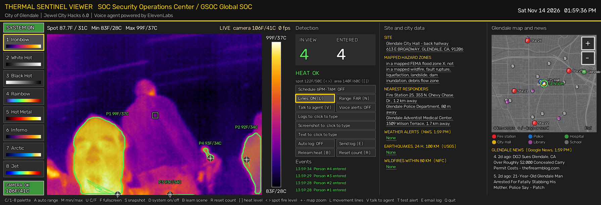
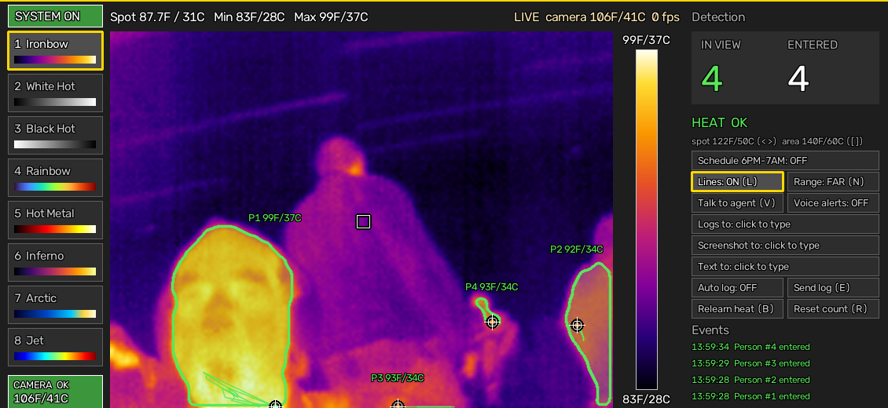
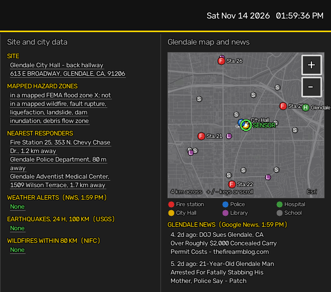
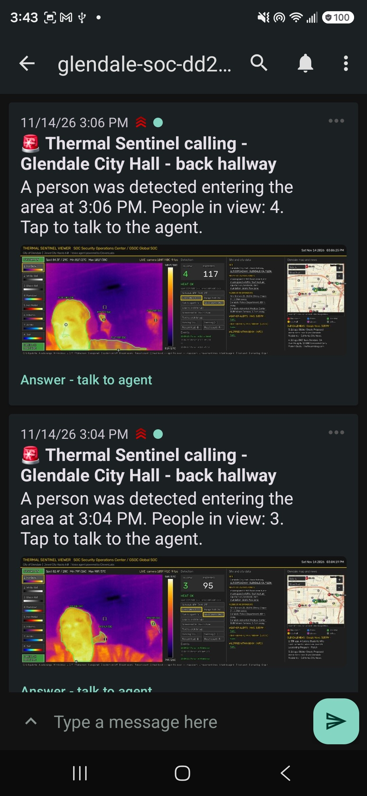
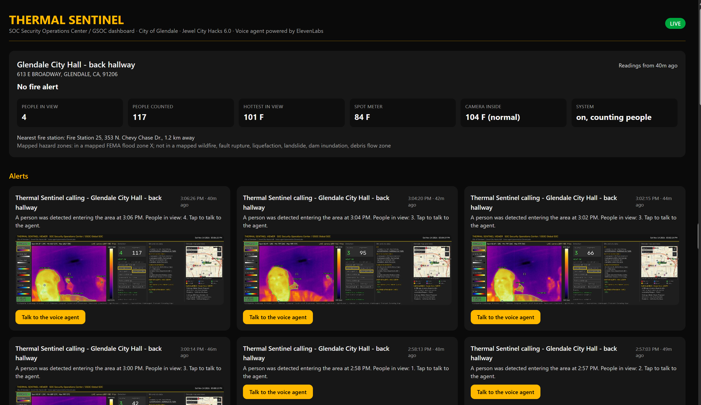
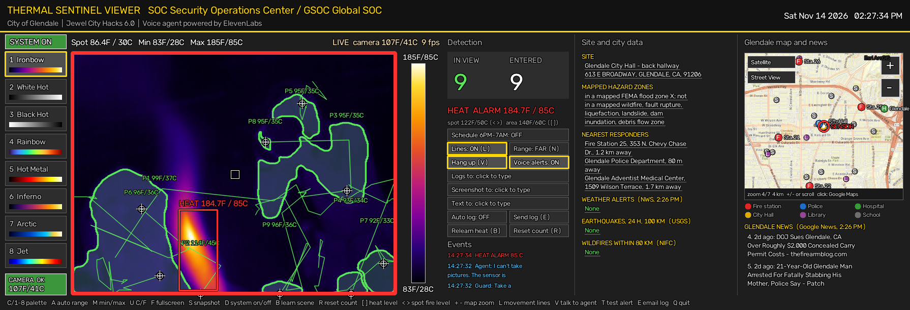
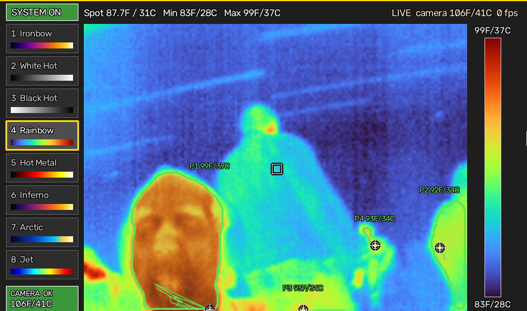

# Thermal Sentinel GSOC

### Jewel City Hacks 6.0

**City of Glendale · Hacker Fund · City of Glendale Economic Development · Alliance for SoCal Innovation**

November 14, 2026 · "Think Globally, Build Locally"

## 🏅 Winner: Top 5 Hackathon Hackers, City of Glendale

> **Source code is private. Code available on request.** This repository holds the project write-up,
> screenshots and the web dashboard page.

## A human-in-the-loop AI security guard that sees heat, not faces

The AI watches around the clock and alerts a human operator, who stays in control and decides when to
bring in police, fire or other agencies.

**A privacy-first thermal security operations (SOC / GSOC) viewer for the City of Glendale, small
businesses and its residents.**

- **One person, one sensor, one screen, a whole command center:** a single operator runs a sensor from
  one interface, with live alerts, live updates, live mapping and an AI agent doing the watching. It
  starts with one sensor per business, so each business has its own, and rolls out to many sensors that
  one operator controls from the same screen, so a city or business needs far fewer people on shift
  and saves real money on security staffing.
- **The purpose:** watch city buildings, libraries, schools and small businesses around the clock, even
  when no guard is at the desk, to **prevent crime and trespassing autonomously** and **catch fire
  hazards early**.
- **Less manpower:** one thermal sensor and an AI agent watch a back hallway, storage room or shop after
  hours, so a city or a business doesn't need a person posted at every door.
- **Lower liability, less burden on the city (the LOSF goal):** it sees heat, not faces, so nobody can be
  identified: no privacy claims, no footage to leak or subpoena. Every event is logged with a time and a
  thermal snapshot as evidence. Early fire warning limits losses, and fewer false alarms mean fewer
  wasted police and fire calls.
- **Constant alerts:** every person who walks in and every new heat source sends a push alert to your
  phone (ntfy app) with the thermal snapshot, plus email.
- **An AI agent on duty:** the ElevenLabs voice agent speaks every alert, answers questions about what
  the sensor sees, knows the city's hazard zones and the nearest fire station, police station and
  hospital, and talks to you on your phone with one tap.
- **Helps police, fire and city government:** responders get a clear, timestamped account of who was
  there and what got hot, and the guard checks with the agent before calling 911, so real emergencies
  get through and false ones don't.

- **Live dashboard:** https://thermal-sentinel-black.vercel.app
- **Code:** https://github.com/sbartstv/thermal-sentinel
- **Phone alerts:** due to time constraints and cost, we decided to use **ntfy** for free phone alerts and
  route the **ElevenLabs voice agent** through ntfy, instead of buying a Twilio phone number. For about
  $20, a Twilio number would add real phone-call alerts on top of the ntfy alerts and the ElevenLabs
  agent; the code for calls is already built and connected.

## Prizes we're entering
- **Best Software Hack**
- **Best Hardware Hack**
- **Grand Champion**
- **ElevenLabs Champion**
- **LOSF extra credit** (startup: helps residents and businesses while lowering liability and burden on the city)
- **Built with Vercel:** the live web dashboard was built with v0 and is hosted on Vercel

## Hardware
- FLIR Lepton thermal sensor
- GroupGets PureThermal USB sensor board
- 6-foot micro-USB to USB-A cable
- 2020 Razer laptop, 32 GB RAM, Windows 11
- Also packaged for Linux: Raspberry Pi and NVIDIA Jetson Orin Nano Super ([linux/](linux/README.md))

## Built with
- **Python** (3.13), coded with **Claude** as my AI coding assistant
- **OpenCV and NumPy** for the thermal vision: body-heat segmentation and people tracking
- **ElevenLabs Agents: the GSOC AI agent.** ElevenLabs is the voice and the brain of the security
  operations center. It runs as two agents: a **desk agent** that speaks out loud through the computer
  and a **phone agent** you reach from any alert. It announces **fire and heat alerts** and **who walks
  into the room**, then answers questions live: how many people are in view, current temperatures, what
  happened earlier, the city's hazard zones and nearest fire station, police and hospital, weather,
  earthquakes and wildfires. It reads the **Glendale news** aloud and opens a story on screen when asked,
  and it can mark a false alarm, switch the system on or off, and email the log.
- **Vercel and v0: the live web dashboard.** Built with v0 and hosted on Vercel, the dashboard shows the
  sensor's live readings (people in view, people counted, temperatures, camera health, fire status)
  and every alert with its thermal snapshot and a button to talk to the voice agent, from any phone or
  computer, anywhere.
- **ntfy: free phone alerts plus the ElevenLabs voice on your phone.** The ntfy app delivers each alert
  to your phone as a push notification, with the thermal snapshot. Its **Answer** button opens the ElevenLabs voice agent
  right on the phone, already briefed on the alert, so you talk to the agent **without needing a phone
  call or a phone number**.
- **Gmail** for email alerts, logs and text messages
- **Glendale GIS MCP** from the Jewel City Hacks organizers (HackerFund/GlendaleGisMcp), run locally on the
  laptop, for hazard zones and nearest responders
- **City of Glendale ArcGIS** (the city's own GIS) for fire stations, police, hospitals, libraries and schools on the map
- **Esri ArcGIS** street and satellite maps
- **National Weather Service, USGS, NIFC and Google News** for live weather alerts, earthquakes, wildfires and news
- **GitHub** for the code

## Features on the screen
- **SYSTEM ON/OFF:** turns people counting and person alerts on or off (fire detection always stays on)
- **In view:** how many people the camera sees right now
- **Entered:** how many people have walked in since the system was switched on
- **8 thermal palettes:** Ironbow, White Hot, Black Hot, Rainbow, Hot Metal, Inferno, Arctic, Jet
- **Schedule:** switches the system on at 6 PM and off at 7 AM by itself
- **Lines:** shows or hides the movement trail behind each person
- **Range NEAR / MID / FAR:** only the person at the desk, a normal room, or everyone in view
- **Segmentation:** a green outline around each person, split apart even when people overlap
- **Temperature on each person's head:** a crosshair with the reading in F and C
- **Fire and heat alerts:** spot meter (122 F) and area alarm (140 F); heat that was already there is ignored
- **Talk to agent:** opens a voice conversation with the ElevenLabs agent; press again to hang up
- **Voice alerts ON/OFF:** whether the agent speaks up by itself when an alert fires
- **Logs to:** email address for the activity log
- **Screenshot to:** email address for the alert screenshot
- **Text to:** phone number for text alerts
- **Auto log / Send log:** email the log hourly, daily, or right now
- **Relearn heat:** re-memorizes what is normally hot in the room
- **Reset count:** sets Entered back to zero
- **Events:** the live list of everything that happened, with times
- **Camera health:** the sensor's own internal temperature, green, amber or red

## Alerts and the ElevenLabs agent
- Every alert goes to your phone as a **push notification in the ntfy app**, with the thermal snapshot
- Tap **Answer** on the alert and the **ElevenLabs voice agent** talks to you right on your phone,
  already briefed on what happened
- So you get phone alerts **and** the ElevenLabs voice without a phone call
- At the desk, the agent speaks every alert out loud through the computer and answers questions
- Alerts also go by email (with the screenshot) and by text message
- **Why no phone call:** the ElevenLabs agent is connected to a Twilio caller ID and the code can place
  real calls, but Twilio's trial won't dial out and a paid number wasn't worth buying for a hackathon
  demo. One setting turns calls on when a paid number is added.

## Site and city data
- City of Glendale **hazard zones** for the site: wildfire, FEMA flood, fault, liquefaction, landslide, dam inundation, debris flow
- **Nearest first responders:** fire station, police station and hospital
- **Weather alerts** (National Weather Service), **earthquakes** (USGS), **wildfires** (NIFC)
- **Glendale news**, clickable, and read aloud by the agent when asked

## Map
- Built from the **City of Glendale's own GIS (ArcGIS)** and the **Glendale GIS MCP** from the
  Jewel City Hacks organizers, on top of **Esri ArcGIS** street and satellite maps
- Marks fire stations, police, hospitals, City Hall, libraries and schools around the sensor
- Street map and satellite view, instant zoom, Google Street View in one click

## About

A dime-sized FLIR Lepton thermal camera watches a hallway, office or shop. Thermal Sentinel counts
the people in view by body heat, outlines each one with a temperature on their head, raises a fire
alert when something new gets hot, and has an ElevenLabs voice agent tell you about it, out loud at
the desk or on your phone. For the site's address it pulls the City of Glendale's own hazard maps and
nearest responders, plus live weather alerts, earthquakes, wildfires and local news.

It sees heat, not faces, so nobody can be identified.

## Screenshots

| People by body heat, with head temperatures | City data, map of responders and local news |
|---|---|
|  |  |

### Phone alerts: ntfy push notifications with the ElevenLabs agent built in

Every alert lands on the phone as a **push notification in the ntfy app**, with the thermal snapshot.
The **Answer - talk to agent** button opens the **ElevenLabs voice agent** right on the phone, already
briefed on that alert, so you get the notification **and** the AI voice without a phone call. We used
ntfy in place of Twilio for cost reasons at the hackathon; **Twilio can be integrated later** for real
text messages and phone calls, and the calling code is already built.

### Web dashboard on Vercel

The live web app, built with **v0** and hosted on **Vercel**: the sensor's readings (people in view,
people counted, hottest temperature, spot meter, camera health, system status), the site's nearest fire
station and hazard zones, and every alert with its thermal snapshot. Each alert has a **Talk to the
voice agent** button that opens the **ElevenLabs agent** from any browser. A **Twilio** integration can
be added later for phone calls and text messages.

### Fire alert

Fire alert: a lighter held in view. The whole view gets a red border, the flame is boxed, and the
ElevenLabs agent says "Heat alert":

Eight color palettes, switchable with one click:

## What it does

- **People detection and counting.** Body-heat segmentation finds each person, near or across the room,
  splits people who overlap by finding each head, outlines them and reads the temperature at the head.
  Range setting: NEAR (only people close to the sensor), MID, or FAR (everyone in view).
- **Fire alert.** A spot meter and an area alarm. Heat that was already in the room (a laptop vent, a
  heater) is learned and ignored; only new heat that lasts several frames raises an alert.
- **ElevenLabs voice agent at the desk.** It speaks each alert in a sentence built from what the sensor
  saw, then answers questions using live tools: people in view, temperatures, recent events, city data
  and news. It can open a news story, mark a false alarm, switch the system on or off, and email the log.
- **ElevenLabs agent on your phone, free.** Each alert arrives as a phone notification with the thermal
  snapshot and an **Answer** button. Tapping it opens the agent in the phone's browser, already briefed
  on the alert. No phone company or Twilio needed.
- **Email and text alerts.** The alert screenshot by email, a text message through the carrier's
  email-to-text gateway, and the activity log emailed on demand, hourly or daily.
- **City of Glendale data.** Wildfire (CAL FIRE), flood (FEMA), fault, liquefaction and landslide (CGS),
  dam inundation (DWR) and debris-flow (USGS) zones for the address, and the nearest fire station,
  police station and hospital, from the Jewel City Hacks Glendale GIS MCP package. A zoomable street map
  marks fire stations, police, hospitals, City Hall, libraries and schools. Every line links out.
- **Live conditions.** National Weather Service alerts, USGS earthquakes in the last 24 hours, active
  wildfires within 80 km (NIFC), and Glendale headlines from Google News.
- **Activity log** with a timestamp and snapshot for every arrival, alert and system change.
- **Night schedule.** The system can switch itself on at 6 PM and off at 7 AM.
- **Camera health.** The sensor's own internal temperature is shown and monitored.
- **Web dashboard** (Next.js on Vercel, built with v0) showing live readings and alerts from anywhere.

## Who it's for

1. **City of Glendale security operations:** City Hall, libraries, the fire department and the police
   real-time center can watch back hallways and after-hours spaces when a guard is away from the desk.
2. **Residents:** ask the agent about the mapped emergency risks at an address and who the nearest
   responders are, straight from the city's own GIS data.
3. **Businesses and residents, with less liability and less burden on the city:** no faces recorded, a
   timestamped evidence log, early fire warning, and fewer false 911 calls because the guard checks with
   the agent first. The agent never claims to dispatch anyone and says to call 911 for a real emergency.

## How it works

| File | What it does |
|---|---|
| `soc_viewer.py` | The window: thermal view, palettes, detection panel, city data, map and news, controls, activity log, schedule, email |
| `detector.py` | Body-heat segmentation, people tracking and counting, fire alarm |
| `alerts.py` | ElevenLabs agents (desk and phone), agent tools, phone push, email, text |
| `gis.py` | Hazard zones and nearest responders for the site address (Glendale GIS MCP package) |
| `live.py` | Weather, earthquake, wildfire and news feeds, the Esri map, city facility locations |

**Hardware:** FLIR Lepton on a PureThermal USB board, read as raw radiometric frames (Y16), so every
pixel is a real temperature. Any Windows laptop works; the same Python code is meant to move to a
Raspberry Pi or Jetson mounted on a wall.

**Detection:** pixels clearly warmer than the room are body heat. Bare skin (faces, hands) is the warm
core of each person; each head is found as its own warm peak, and a watershed grows it into that
person's silhouette, so people who overlap get separate outlines. Tracks must last about half a second
to count.

**Voice:** ElevenLabs Agents. The desk agent runs through the ElevenLabs Python SDK with seven client
tools wired into the live app. The phone agent is opened from a link that carries the alert's facts as
dynamic variables.

## Source code

The source code for Thermal Sentinel is private. **Code available on request.**

Runs on Windows with Python 3.13 and a FLIR Lepton on a PureThermal board. No camera? Press **P** on
the "Looking for the FLIR Lepton" screen to play a recorded demo.

### Keys

`D` system on/off · `V` talk to the agent / hang up · `N` range · `B` relearn heat · `R` reset count ·
`L` movement lines · `+ -` map zoom · `< >` spot fire level · `[ ]` area heat level · `U` units ·
`E` email log · `1-8` palette · `S` snapshot · `F` full screen · `Q` quit

## Built with

Python, OpenCV, NumPy, FLIR Lepton, PureThermal, ElevenLabs Agents, ElevenLabs Python SDK,
Glendale GIS MCP, ArcGIS, ntfy, Gmail SMTP, National Weather Service, USGS, NIFC, Google News,
Next.js, v0, Vercel

## Notes

- Temperatures are read from a 160 by 120 sensor. Readings on people far from the camera blend with
  hair and background and read a few degrees low.
- Hazard zones are regulatory maps, not a site assessment; they are not live conditions.
- Thermal images show heat only and cannot identify a person. In an emergency, call 911.

## Why push notifications instead of phone calls
We could have used **Twilio** for real phone calls and text messages: the ElevenLabs agent is already
connected to a Twilio caller ID and the calling code is built. But a Twilio trial account won't dial out,
and we didn't want to pay for a phone number for a hackathon demo. So we decided on **free push
notifications through the ntfy app**, with the **ElevenLabs voice agent** one tap away on the phone.
Adding a paid Twilio number (about $20) turns on real phone-call alerts with one setting.
